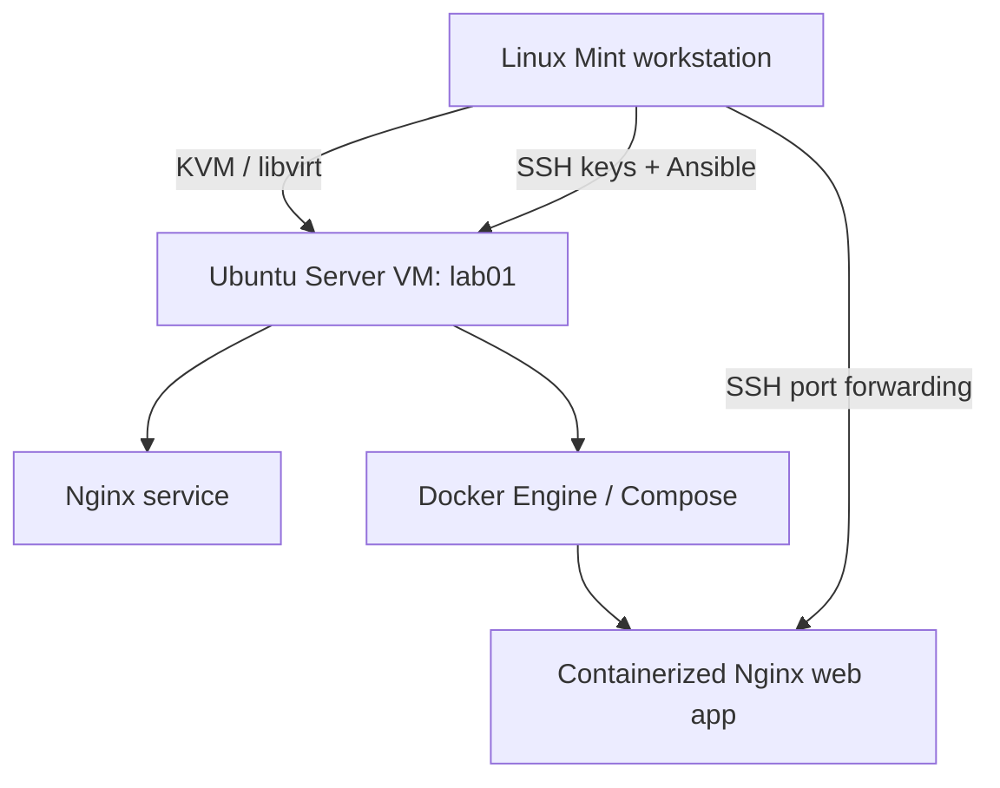

# Linux, Networking & Infrastructure Automation — Home Lab Portfolio

A growing collection of self-directed, hands-on projects focused on Linux administration, virtualization, network security, automation, containers, and cloud engineering.

**These are personal lab projects, separate from employer systems and data.**

## Lab environment

| Layer | Tools and configuration |
| --- | --- |
| Hardware | Dell OptiPlex 9020 SFF · Intel Core i7-4770 · 16 GB RAM · 512 GB-class SATA SSD |
| Workstation | Linux Mint 22.3 Cinnamon |
| Virtualization | KVM/QEMU, libvirt, Virtual Machine Manager |
| Server | Ubuntu Server VM (`lab01`); guest version to be verified |
| Networking | libvirt NAT, SSH key authentication, UFW, local HTTP testing |
| Automation & containers | Ansible, Git, Docker Engine, Docker Compose, Nginx |

## Featured projects

### 01 · [Virtualized Linux Server Administration](linux-server-administration/README.md)

Provisioned a Linux server VM using KVM/QEMU; configured remote SSH access, host firewall rules, and a working Nginx test page. Documented troubleshooting for a missing SSH service and authentication failures.

**Skills:** Linux · KVM · SSH · UFW · Nginx · TCP/IP · troubleshooting

### 02 · [Infrastructure Automation with Ansible](ansible-nginx-automation/README.md)

Built an Ansible inventory and playbook to manage Nginx and web content on the Ubuntu VM. Confirmed connectivity with `ansible.builtin.ping` returning `SUCCESS` / `pong`. Playbook execution was reported complete; a repeat-run `changed=0` capture is still pending.

**Skills:** Ansible · YAML · inventory management · SSH · configuration automation

### 03 · [Docker Containerization & Secure Web Deployment](docker-containerization/README.md)

Built a custom Nginx image and deployed a static site using Docker Compose. Used loopback-only port binding and an SSH tunnel to reach the service from the Linux Mint workstation. Source files include the actual `Dockerfile`, `compose.yaml`, and site HTML.

**Skills:** Docker · Docker Compose · container networking · port mapping · SSH tunneling

## Architecture

All services are intended for a private personal lab; they are not described as publicly exposed production services.

## Evidence and documentation

Each project has its own README with goals, implementation, architecture, troubleshooting, and verification notes. See the [verification checklist](docs/verification-checklist.md) for evidence still needed. Reported completions are distinguished from directly captured terminal output.

**Publishing safety:** Never commit SSH private keys, credentials, tokens, or sensitive configuration. Review screenshots before uploading.

## What's next

- Add verified screenshots of Ansible playbook runs, firewall state, and Docker deployment
- Test Ansible idempotency and capture a second-run `changed=0` recap
- Learn Terraform infrastructure as code, followed by an Azure sandbox with budget limits
- Expand networking, Linux troubleshooting, and monitoring projects

[Draft of the GitHub profile README](docs/github-profile-README.md) — ready to copy into a public repository named `SollieNaylor` when that profile repository is created.
