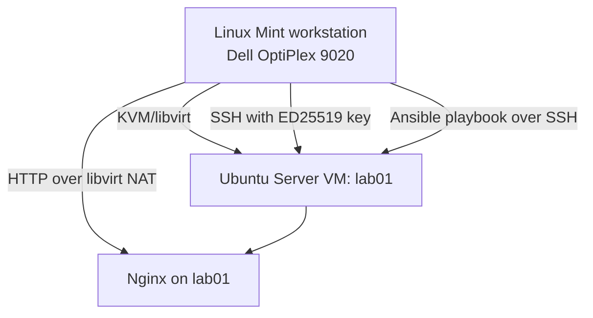

# Linux, Networking & Infrastructure Automation — Home Lab Portfolio

A hands-on collection of self-directed infrastructure projects focused on Linux systems administration, virtual networking, remote access, security configuration, and repeatable automation.

## Lab environment

- **Host:** Dell OptiPlex 9020 SFF, Intel Core i7-4770, 16 GB RAM, ~512 GB SATA SSD
- **Host OS:** Linux Mint 22.3 Cinnamon
- **Virtualization:** KVM/QEMU managed with Virtual Machine Manager (libvirt)
- **Guest:** Ubuntu Server (`lab01`; exact installed version to be confirmed)
- **Networking:** libvirt NAT network; SSH from the host to the guest
- **Configuration tools:** Ansible, YAML, Nginx, OpenSSH, UFW, Git

## Featured projects

| Project | What it demonstrates | Evidence status |
|---|---|---|
| [01 — Virtualized Linux server](linux-server-administration/README.md) | KVM provisioning, SSH, firewall, service administration, Nginx | SSH access and service setup reported complete; supporting screenshots pending |
| [02 — Nginx automation with Ansible](ansible-nginx-automation/README.md) | Inventory, remote automation, configuration management, playbooks | `ansible.builtin.ping` returned `SUCCESS` / `pong`; playbook run reported complete; repeat-run evidence pending |

## Architecture

The guest uses a virtual NAT network and is intended for private lab testing, not internet-facing production hosting.

## What I practiced

- Enabling and validating Intel VT-x / KVM support
- Building and accessing a virtual Linux server
- Troubleshooting OpenSSH service installation and login issues
- Setting up SSH keys and a firewall for remote administration
- Hosting and testing a web page with Nginx
- Defining an Ansible inventory and reaching a host using Python on the remote system
- Writing a playbook to install, start, and configure a web service

## Documentation and evidence

See [verification checklist](docs/verification-checklist.md) for what is confirmed versus awaiting evidence. These write-ups intentionally avoid inflated claims or benchmark figures. Commands and sample configuration are sanitized; no credentials, private keys, or actual internal IP addresses are published.

## Next projects

1. Verify repeatability by running the Nginx Ansible playbook twice and recording `changed=0` on the second run.
2. Manage this repository using Git commits and change reviews.
3. Containerize a small application with Docker or Podman.
4. Recreate a sandbox environment using Terraform and Azure with cost guardrails.

> This is a learning lab. It is not affiliated with or built on employer infrastructure or employer data.

## Projects

### Docker Containerization & Secure Web Deployment

Built and deployed a custom Nginx Docker image on an Ubuntu Server virtual machine using Docker Compose.

**Technologies:** Docker, Docker Compose, Nginx, Ubuntu Server, Linux, SSH

**Skills demonstrated:**
- Building custom Docker images
- Container lifecycle management
- Configuring Docker Compose
- Container networking and port mapping
- Secure remote access using SSH tunneling

[View Docker Project](docker-containerization/README.md)
