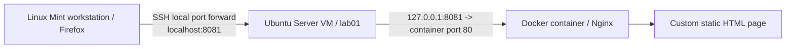

# Docker Containerization & Secure Web Deployment

**Project type:** Personal Linux home lab  
**Status:** Implemented and tested locally  
**Environment:** Dell OptiPlex 9020 workstation running Linux Mint; Ubuntu Server virtual machine (`lab01`) under KVM/QEMU  
**Technologies:** Docker Engine, Docker Compose, Nginx, Ubuntu Server, SSH, Linux networking, Git

## Overview

Built a containerized static web application on an Ubuntu Server virtual machine. Created a custom Docker image using an Nginx Alpine base image and deployed it with Docker Compose. Exposed the service only on the virtual machine's loopback interface and accessed it from the Linux Mint workstation through an SSH local port-forward.

This project demonstrates practical use of container images, declarative application deployment, Linux services, port mapping, remote administration, and network exposure controls.

## Architecture



- **Host system:** Linux Mint on Dell OptiPlex 9020.
- **Virtualization layer:** KVM/QEMU using Virtual Machine Manager.
- **Server:** Ubuntu Server VM, administered over SSH.
- **Container:** Nginx serving the project's `site/index.html`.
- **Network design:** Docker publishes TCP port 80 to `127.0.0.1:8081` **on the Ubuntu VM**. An SSH tunnel forwards `localhost:8081` on Linux Mint to that port.

The custom container uses port **8081** to avoid conflicting with an earlier test Nginx container listening on port 8080.

## Project files

```text
docker-containerization/
├── Dockerfile
├── compose.yaml
├── site/
│   └── index.html
└── screenshots/          # Add sanitized evidence images here
```

The `Dockerfile`, `compose.yaml`, and `site/index.html` in this repository are the source files used in the lab. The application is intentionally simple so the emphasis stays on deployment, operations, and networking.

## How to reproduce

**Prerequisites:** An Ubuntu Linux host or VM with Docker Engine and the Docker Compose plugin installed; a user authorized to run Docker; and an SSH-accessible host for remote viewing.

On the Ubuntu Server VM:

```bash
cd docker-containerization
sudo docker compose config
sudo docker compose up -d --build
sudo docker compose ps
curl -I http://127.0.0.1:8081
```

The expected HTTP result is `200 OK` and the Compose service should show as running.

From a separate terminal on the Linux Mint workstation:

```bash
ssh -N -L 8081:127.0.0.1:8081 <ubuntu-user>@<vm-ip>
```

With the SSH tunnel open, browse to **http://localhost:8081** on Linux Mint. Substitute your own username and private lab IP address; they are intentionally not included in this public documentation.

To stop the Compose deployment without removing the project files:

```bash
sudo docker compose down
```

## Validation

During the lab, I tested the Docker installation with the `hello-world` image, started an Nginx container, built a custom image, and deployed it through Docker Compose. I also tested the local HTTP response and opened the custom website through an SSH tunnel from the workstation.

**Evidence to add after redaction:**

| Evidence | Suggested file name | What it demonstrates |
|---|---|---|
| `hello-world` output and Docker version | `01-docker-installation.png` | Docker runtime validation |
| `docker ps` and HTTP 200 response | `02-running-container.png` | Container runtime and service check |
| Browser showing initial Nginx page | `03-containerized-website.png` | Access over SSH tunneling |
| `docker compose ps` and HTTP 200 response | `04-docker-compose-deployment.png` | Declarative deployment |
| Browser showing custom page on localhost:8081 | `05-custom-docker-website.png` | Completed application deployment |

Do not publish screenshots until usernames, IP addresses, tokens, host identifiers, or other details you do not want public have been reviewed and redacted. Only link screenshots here once those files actually exist in the repository.

## Troubleshooting and lessons learned

- **Docker GPG key setup:** A misplaced backslash in a `curl` command printed the public signing key to the terminal rather than writing it to the intended keyring file. Correcting the command and verifying the `.asc` file resolved the setup issue.
- **Port selection:** Used 8081 for the Compose deployment to avoid conflict with the earlier 8080 test container.
- **File transfer:** Corrected an `scp` argument-spacing issue when transferring the Docker project files from Ubuntu to Linux Mint for version control.
- **Security:** Kept the published Docker port bound to loopback. Used SSH forwarding rather than exposing the development service broadly to the network.

## Skills demonstrated

- Building and running container images with a Dockerfile
- Deploying and managing a containerized service with Docker Compose
- Linux command-line administration and SSH-based remote access
- HTTP validation using `curl` and container inspection using `docker ps`
- Understanding host/container ports and loopback binding
- Documenting infrastructure as reproducible, version-controlled configuration

## Possible next iterations

- Add a Docker health check and validate health status.
- Pin a tested base-image digest or specific version for more reproducible builds.
- Add a non-production CI workflow that validates `compose.yaml` and builds the image.
- Use Ansible to install Docker and deploy the Compose project to a fresh VM.

---

*Personal learning project. No employer infrastructure, credentials, or proprietary data are included.*
