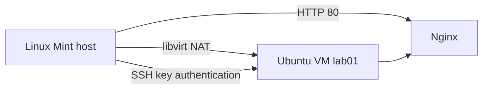

# Project 01 — Virtualized Linux Server Administration

## Executive summary

Built a Linux server lab on a repurposed Dell OptiPlex workstation. Installed Linux Mint on an upgraded SATA SSD, enabled KVM-based virtualization, created an Ubuntu Server VM, established remote SSH access, configured a host firewall, and deployed an Nginx-served test webpage. The environment provides an isolated place to practice systems administration and networking without using employer systems.

## Goals

- Create a functioning Linux VM on a personal host.
- Connect securely from the host to the VM using SSH.
- Apply basic inbound firewall controls.
- Serve and validate an HTTP page from the VM.
- Record operational checks and troubleshooting decisions.

## Environment / tools

| Item | Description |
|---|---|
| Physical host | Dell OptiPlex 9020 SFF, Intel i7-4770, 16 GB RAM, 512 GB-class SSD |
| Desktop OS | Linux Mint 22.3 Cinnamon, kernel observed: 6.14.0-37-generic |
| Virtualization | KVM/QEMU + libvirt + Virtual Machine Manager |
| Guest | Ubuntu Server VM, `lab01` (verify installed version with `cat /etc/os-release`) |
| Planned VM size | 2 vCPU, 3 GiB RAM, 30 GiB virtual disk; verify actual VM configuration |
| Network | Default libvirt NAT virtual network |
| Services | OpenSSH, UFW, Nginx |

## Architecture

## Implementation overview

1. Confirmed VT-x with `lscpu` and KVM device availability at `/dev/kvm`.
2. Installed KVM/libvirt and Virtual Machine Manager on the Linux Mint host.
3. Created an Ubuntu Server virtual machine with NAT networking and a virtual disk.
4. Installed and enabled `openssh-server` after the initial `ssh.service` check showed the unit was missing.
5. Resolved an SSH authentication issue and successfully connected from Linux Mint.
6. Generated and loaded an ED25519 SSH key on the host, copied the public key to the VM, and successfully accessed the server.
7. Allowed SSH before enabling UFW; later allowed TCP port 80 for the Nginx test service.
8. Installed Nginx and created a basic HTML test page, accessible from the workstation (reported complete; screenshot pending).

## Troubleshooting notes

**Missing `ssh.service`:** An initial attempt to check SSH returned `Unit ssh.service could not be found`. Installing `openssh-server` on the guest and starting the `ssh` service addressed the missing service. 

**SSH login denied:** The client could reach the guest but initially received `Permission denied`. Verified account context, addressed password/authentication setup, and later reported a successful SSH login. The precise root cause of the initial denial was not recorded and should not be asserted as fact.

**SSH key location:** Attempting `ssh-add` while logged into the VM failed because the private key was stored on the Linux Mint host. Running it locally loaded the key successfully.

## Validation

- [x] Host reports Intel VT-x.
- [x] Host exposes `/dev/kvm`.
- [x] Ubuntu VM created and user reported SSH access works.
- [x] SSH key was added on the Linux Mint host (terminal output observed).
- [x] Firewall and Nginx configuration reported complete.
- [ ] Capture redacted `systemctl status ssh` and `sudo ufw status verbose` output.
- [ ] Capture screenshot of the custom Nginx page.
- [ ] Record actual guest version, CPU, memory, disk, and IP-redacted network configuration.

## Security boundaries

The VM is reached through a local NAT virtual network. Public port forwarding is not part of the project. Keep private keys on the workstation, never commit secrets, and redact IP addresses, host fingerprints, and usernames when sharing logs.

## Lessons and next steps

This project built familiarity with the difference between a virtualization host and guest, Linux service lifecycle management, SSH authentication, firewall exceptions, and validating HTTP access across a virtual network. The next step is automated configuration management with Ansible.

## Evidence

Add sanitized screenshots to [`screenshots/`](screenshots/README.md) and document the verification date next to each one.
