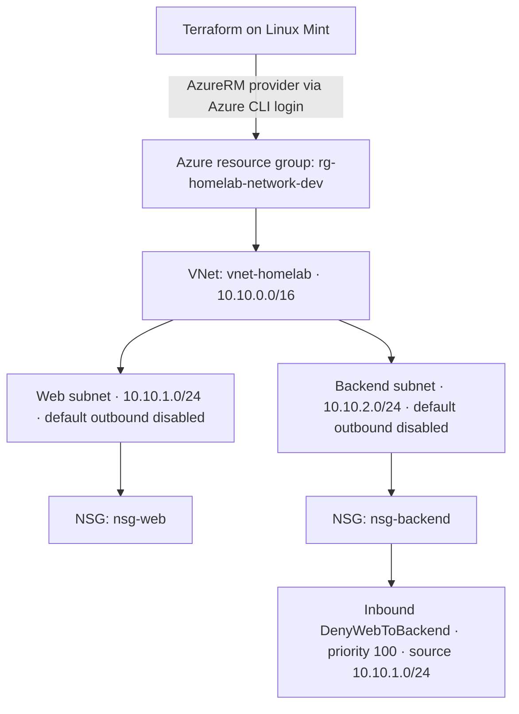

# Project 04 — Terraform Azure Network Infrastructure

**Type:** Independent personal home lab  
**Status:** Completed — deployment, verification, drift check, and teardown verified on November 25, 2026  
**Environment:** Linux Mint workstation, Terraform CLI, Azure CLI, AzureRM provider  
**Region:** South Central US (`southcentralus`)

## Executive summary

Provisioned Azure networking resources from declarative Terraform configuration. Created a resource group, VNet, separate web/backend subnets, two network security groups, a restrictive inbound rule on the backend NSG, and associations between each subnet and its NSG.

**Observed deployment result:** `Apply complete! Resources: 9 added, 0 changed, 0 destroyed.`  
**Observed drift check:** `No changes. Your infrastructure matches the configuration.`  
**Observed teardown:** `Destroy complete! Resources: 9 destroyed.`; Azure resource group existence returned `false`, and `terraform state list` returned no resources.

This project demonstrates Terraform planning and deployment, Azure virtual networking, network security policy configuration, and drift detection. It uses a personal Azure environment, not employer infrastructure.

## Architecture



The diagram represents configuration and control relationships, not live packet flows. The inbound NSG rule restricts traffic from the web subnet to resources in the backend subnet. No VMs were deployed, so **the rule has not been validated through an actual inter-subnet traffic test**. Other traffic is governed by Azure's applicable default NSG rules.

## Planned and created resources

| Count | Resource |
| ---: | --- |
| 1 | `rg-homelab-network-dev` — resource group |
| 1 | `vnet-homelab` — virtual network (`10.10.0.0/16`) |
| 2 | `snet-web` (`10.10.1.0/24`) and `snet-backend` (`10.10.2.0/24`) |
| 2 | `nsg-web` and `nsg-backend` |
| 1 | `DenyWebToBackend` inbound security rule |
| 2 | Subnet-to-NSG associations |
| **9** | **Total Terraform resources** |

## Implementation workflow

1. Installed Terraform and Azure CLI on the personal Linux Mint workstation.
2. Authenticated with a personal Azure subscription.
3. Registered the `Microsoft.Network` resource provider.
4. Authored AzureRM configuration and explicitly disabled automatic outbound access on both subnets.
5. Ran `terraform init`, `terraform fmt`, `terraform validate`, and `terraform plan`.
6. Reviewed the proposed nine creations before `terraform apply`.
7. Applied the plan, which reported **9 added / 0 changed / 0 destroyed**.
8. Re-ran `terraform plan`; state refresh reported **no changes**.
9. Verified deployed subnet settings, NSG associations, and inbound deny rule with Azure CLI.
10. Reviewed `terraform plan -destroy` (`0 to add, 0 to change, 9 to destroy`) and completed `terraform destroy` (`9 destroyed`).
11. Confirmed `az group exists --name rg-homelab-network-dev` returned `false` and `terraform state list` returned no managed resources.

## Verification evidence

| Check | Observed result | Status |
| --- | --- | --- |
| `terraform validate` | `Success! The configuration is valid.` | Verified |
| `terraform plan` before deployment | `Plan: 9 to add, 0 to change, 0 to destroy.` | Verified |
| `terraform apply` | `Apply complete! Resources: 9 added, 0 changed, 0 destroyed.` | Verified |
| `terraform plan` after deployment | `No changes. Your infrastructure matches the configuration.` | Verified |
| Web subnet `defaultOutboundAccess` | `False` | Verified via Azure CLI |
| Backend subnet `defaultOutboundAccess` | `False` | Verified via Azure CLI |
| Web subnet CIDR | `10.10.1.0/24` from `addressPrefixes` | Verified via Azure CLI |
| Backend subnet CIDR | `10.10.2.0/24` from `addressPrefixes` | Verified via Azure CLI |
| Web subnet NSG | `nsg-web` | Verified via Azure CLI |
| Backend subnet NSG | `nsg-backend` | Verified via Azure CLI |
| Backend inbound deny rule | `DenyWebToBackend`, `Deny`, `Inbound`, source `10.10.1.0/24`, priority `100` | Verified via Azure CLI |
| Real network traffic blocked | Not tested: no compute resources deployed | Pending |
| Pre-destroy Terraform plan | `Plan: 0 to add, 0 to change, 9 to destroy.` | Verified |
| `terraform destroy` | `Destroy complete! Resources: 9 destroyed.` | Verified |
| Azure resource group cleanup | `az group exists --name rg-homelab-network-dev` returned `false` | Verified via Azure CLI |
| Local Terraform state cleanup | `terraform state list` returned no resources | Verified |

**Subnet CIDR verification:** The first Azure CLI table did not display CIDRs because it selected `addressPrefix` (singular). A subsequent `addressPrefixes` query returned `10.10.1.0/24` for `snet-web` and `10.10.2.0/24` for `snet-backend`, both with `defaultOutboundAccess` set to `false`.

Example command for a CIDR recheck:

```bash
az network vnet subnet list \
  -g rg-homelab-network-dev \
  --vnet-name vnet-homelab \
  --query "[].{Name:name,Prefixes:addressPrefixes,Outbound:defaultOutboundAccess}" \
  -o json
```

## Files and reproducibility

- [`main.tf`](main.tf) — sanitized Terraform configuration corresponding to the documented infrastructure; **reconstructed from the lab configuration and apply output; compare it with the authoritative local `main.tf` before asserting byte-for-byte identity**.
- [`.gitignore`](.gitignore) — excludes state, plan files, variable secrets, and provider downloads.
- [Screenshot evidence checklist](screenshots/README.md) — screenshots to capture after redacting subscription and account identifiers.

On a workstation with Terraform, Azure CLI, a personal Azure subscription, and appropriate permissions:

```bash
terraform init
terraform fmt -check
terraform validate
terraform plan
# Review and approve the plan before running terraform apply.
```

The Azure lab has been destroyed. To recreate it, review the configuration against your local working copy, authenticate to your personal Azure subscription, inspect a fresh `terraform plan`, and apply only after confirming the intended scope. Keep Terraform state local/private and never commit it.

## Security and cost boundaries

- No virtual machines, public IP addresses, gateways, or databases were deployed in this phase.
- Subnets have `default_outbound_access_enabled = false`; this does not by itself implement a comprehensive egress policy for all future services.
- Budget alert setup was recommended but **has not been verified** in this project log. Azure budget alerts notify; they do not enforce a hard spending limit.
- Do **not** commit `terraform.tfstate`, plan files, `*.tfvars` containing secrets, Azure credentials, subscription IDs from logs, or unredacted portal screenshots.
- Creating networking resources alone generally has limited or no direct resource charges, but related services and future additions may have costs. Verify pricing and cost controls for your account before expanding the lab.

## Lessons learned and next steps

Terraform creates and tracks infrastructure, while Ansible manages software and configuration on existing systems. Here, Terraform demonstrated provisioning, state refresh, verification against real Azure resources, and detection of configuration drift.

The lab was successfully destroyed and cleanup verified on November 25, 2026. Remaining portfolio housekeeping: capture/redact screenshots and compare the published reference `main.tf` with the authoritative local configuration.

**Recruiter summary:** Provisioned, verified, and cleanly decommissioned nine Azure networking resources with Terraform, including two subnets, NSGs, a custom inbound deny rule, and zero-drift validation.
